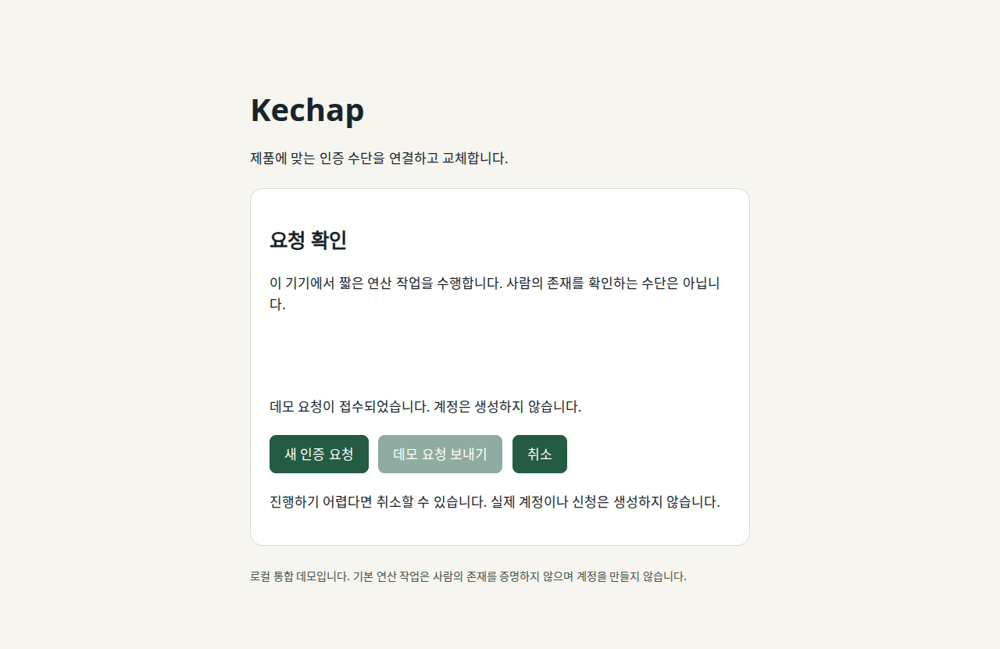

# Kechap

제품에 맞는 CAPTCHA·사람 검증 수단을 **고르고, 연결하고, 서버 정책으로 교체**하는 오픈소스입니다. SDK가 인증을 집행하고 MCP·CLI·Skill이 에이전트의 설치 작업을 돕습니다. 새로운 게임이나 얼굴 모델 하나가 모든 문제를 해결한다고 가정하지 않습니다.

현재는 **실행 가능한 초기 MVP**입니다. 운영 보안 감사·인간 참가자 실험·상용 벤더 인증은 아직 아닙니다.



## 바로 실행

Node.js 20 이상과 npm이 필요합니다. 조사 도구에는 Python 3와 인증된 GitHub CLI가 추가로 필요합니다.

```bash
npm ci --omit=optional
npm test
npm run catalog:check
npm run test:research
npm run demo:web
```

`http://localhost:3000`에서 기본 PoW 폼을 사용할 수 있습니다. 연산 작업은 사람의 존재를 증명하지 않습니다.

## 에이전트에게 설치시키기

이 저장소와 제품 코드를 코딩 에이전트에 연결하고 다음처럼 요청합니다.

> 가입 폼에 Kechap을 붙여줘. 자체 호스팅이 필요하고 제3자 추적은 금지해. 서버 검증·일회성 소비와 접근성 대체 경로까지 설정해줘. 근거가 없는 보안 주장은 하지 마.

MCP는 후보 조회, 설명 가능한 추천, 통합 계획, 신규 Node HTTP 프로젝트 파일 생성을 제공합니다. 기존 제품의 임의 코드를 자동 수정하는 범용 설치기는 아직 아닙니다.

```json
{"mcpServers":{"kechap":{"command":"node","args":["/absolute/path/to/Kechap/src/mcp.js"]}}}
```

도구는 `kechap_catalog`, `kechap_recommend`, `kechap_plan`, `kechap_scaffold`, `kechap_setup`입니다. `kechap_setup`은 제품 요구사항으로 후보를 필터한 뒤 선택·설치 파일 생성을 연결합니다. 조건을 만족하지 못하면 파일을 생성하지 않고 이유를 반환합니다. [설치 Skill](skills/kechap/SKILL.md)은 이 저장소를 유지한 상태로 사용하세요.

CLI로 새 통합 프로젝트를 만들 수 있습니다. 목적지가 이미 존재하면 덮어쓰지 않습니다.

```bash
npm run scaffold -- /tmp/my-product '{"requirements":{"selfHosted":true,"noThirdParty":true,"assurance":"automation-cost","requireLiveEvidence":true}}'
cd /tmp/my-product
npm install --omit=optional
cp .env.example .env
# .env의 ALTCHA_SECRET에 32바이트 이상의 서버 전용 난수 문자열 설정
npm start
```

지원 생성 공급자: `pow`, `altcha`, `cap`, `turnstile`, `hcaptcha`, `recaptcha`. reCAPTCHA는 `recaptchaMode: "v2"` 또는 `"v3"`를 명시합니다. 상용 키는 공급자 계정에서 발급해야 합니다. 생성 예제는 실제 계정을 만들지 않으며 보호된 작업을 연결할 지점을 보여 줍니다.

## 구현한 인증 경로

| 수단 | 구현·검증 범위 | 보증 범주 |
| --- | --- | --- |
| ALTCHA | 공식 altcha-lib 2.8.0, v2 SHA-256, 실제 패키지 및 Chromium 폼 테스트 | automation-cost |
| Cap | 공식 capjs-core 0.1.15, format 1 SHA-256, 실제 패키지 및 Chromium 폼 테스트 | automation-cost |
| 자체 PoW | 실험·비교용, Chromium 폼 테스트 | automation-cost |
| Turnstile·hCaptcha·classic reCAPTCHA | 공식 서버 endpoint 어댑터, hostname/action/score·오류 처리 모의 테스트 | bot-mitigation |
| 세 가지 toy replay | 정적 선택·drag/rotate·동적 순서의 서버 이벤트 재생 및 스크립트 기준선 | interaction |
| liveness·identity·uniqueness | 후보와 확장 계획. 현재 런타임 구현 없음 | 서로 별개 |

Cap의 HashWX·instrumentation·behavior scoring은 이 baseline에서 활성화하지 않습니다. 상용 공급자의 실제 계정 연동 검증은 별도입니다. 재생 가능한 입력과 사람의 존재는 다른 주장입니다. [OSS 근거와 계약](docs/oss-integrations.md), [외부 라이선스 고지](THIRD_PARTY_NOTICES.md)를 확인하세요.

## 서버 SDK

```js
import {Kechap} from './src/index.js';
import {altchaAdapter, capAdapter} from './src/oss.js';

const kechap = new Kechap({adapters: {
  altcha: altchaAdapter({secret: process.env.ALTCHA_SECRET}),
  cap: capAdapter({secret: process.env.CAP_SECRET}),
}});
const context = {tenant: 'product', action: 'signup', subject: 'server-derived-session'};
const challenge = await kechap.issue({context, sessionId: 'server-session',
  providers: ['altcha', 'cap'], assurance: 'automation-cost', mode: 'rotate', previous: 'altcha'});
// 공개 challenge를 browser mountChallenge에 전달하고 응답을 서버로 받습니다.
const verified = await kechap.verify({id: challenge.id, context, response: browserResponse});
if (!verified.ok) throw new Error('Verification failed');
const consumed = await kechap.consume({token: verified.token, context});
if (!consumed.ok) throw new Error('Expired or already used');
// 제품의 보호된 작업 실행. DB 트랜잭션/멱등성은 제품에서 처리합니다.
```

`MemoryStore`는 단일 프로세스 개발용입니다. 운영에서는 원자적 `put(key,value,expiresAt)`/`take(key)` 공유 저장소, 실제 제품 세션·CSRF·속도 제한·요청 크기 제한·HTTPS·접근성 복구 경로가 필요합니다. 소비와 업무 처리의 원자성은 별도로 설계해야 합니다. 실패한 검증 시도도 challenge를 소비하므로 다시 발급해야 합니다.

브라우저는 `src/browser.js`의 `mountChallenge(container, issued, {onResponse,onError,signal})`을 사용합니다. 교체 시 abort하면 이전 widget과 콜백을 정리합니다. 외부 벤더 스크립트는 해당 방식 선택 시 로드합니다. Turnstile은 challenge별 cData를 검사합니다. hCaptcha/classic reCAPTCHA의 원본 토큰은 동일 site/action의 bearer proof이며 원래 브라우저 세션의 존재까지 증명하지 못합니다.

## 추천과 로테이션

```bash
npm run recommend -- '{"selfHosted":true,"assurance":"automation-cost","requireLiveEvidence":true}'
npm run recommend -- '{"useCase":"reward","minStars":10000}'
```

추천은 self-host/제3자 금지, 용도, assurance, 최소 별 수, 테스트 근거, 실험 허용, modality와 제외 목록을 확인하고 공급자별 탈락 이유를 반환합니다. 지원하지 않는 제약은 무시하지 않고 오류로 돌려줍니다. 연락 폼·가입 기본 요구와 리워드 uniqueness·복구 identity 요구를 구분합니다. 기본 요구는 제품별 조정이 필요한 예시이며 보안 등급 인증이 아닙니다.

`issueWithPolicy`는 서버의 action·risk별 공급자 집합, stable/rotate/weighted 방식, health와 정책 버전을 사용합니다. 발급된 challenge는 원래 공급자·assurance·정책 버전에 고정됩니다. 다른 범주의 자동 fallback이나 전체 장애 시 자동 통과는 없습니다. risk 입력·health는 신뢰된 서버가 제공해야 합니다. 자체 위험 점수 모델과 기기/IP 수집기는 아직 구현하지 않았습니다. [정책 예제](docs/runtime-policy.md)를 참고하세요.

## 조사 결과

[실시간 조사](docs/research.md)와 [기존 프로젝트 비교](docs/comparison.md)에 공식 출처·라이선스·고정 revision·조회 시각·근거 hash를 기록했습니다. 카탈로그는 50개 역할별 후보이며, 모든 항목이 실행 어댑터나 검증 완료 CAPTCHA인 것은 아닙니다.

- 관련 목록은 이미 있습니다: awesome-captcha, awesome-proof-of-personhood 등.
- CAPTCHA MCP도 있으나 조사 표본 상당수는 인증 해제 솔버입니다. 최초·유일을 주장하지 않습니다.
- ALTCHA 2,897, Cap 8,352, mCaptcha 2,501 stars로 조사 시점에 10K 미만입니다. Anubis·FingerprintJS·SafeLine·CrowdSec은 10K 이상이지만 프록시·신호·위험 방어 역할입니다.
- npm 다운로드·maintainer 도입 주장은 별도 근거이며 고유 고객 수나 독립 감사로 바꾸어 쓰지 않습니다.
- REA는 Linux 일부 분석을 지원하며 별도 최신 Node 요구가 있습니다. 이번에는 문서·라이선스만 확인했고 실행·비공개 엔진 추출은 하지 않았습니다. 상용 제품은 공식 API로 연결합니다.

Aside와 Windows VM은 사용자 지시에 따라 실행하지 않았습니다.

## 벤치마크와 검증

```bash
npm run benchmark -- 100
npx playwright install chromium
npm run test:browser
```

`npm test`는 현재 50개 테스트를 실행하며 Python 조사 테스트 3개는 별도입니다. Chromium 테스트는 소유한 폼에서 ALTCHA·Cap·PoW 교체와 실제 서버 제출을 확인합니다. 브라우저가 제한된 환경이면 해당 검증을 별도로 실행해야 합니다.

세 가지 toy surface의 rule-aware script는 각각 100/100 성공했습니다. 이는 **서버 replay만으로 사람과 자동화를 구분할 수 없다는 결과**입니다. 인간·VLM·접근성 데이터는 아직 없으며 허구 수치를 채우지 않습니다. [벤치 프로토콜과 결과 한계](docs/benchmark.md)를 확인하세요.

실제 실행 원본은 [toy baseline JSON](benchmarks/results/2026-11-12-toy-baseline.json), [Chromium 검증 기록](docs/assets/browser-verification.json)에 포함했습니다. client timeline은 시뮬레이션이고 verifier CPU만 실측임을 결과에 명시했습니다.

## 기여·계획·후원

[기여 방법](CONTRIBUTING.md), [보안 상태](SECURITY.md), [상세 로드맵](docs/roadmap.md), [게시한 이슈 24개](docs/issues.md)에 실제 패키지 통합·분산 저장소·접근성·영상/음성 승격·인간/에이전트 실험·리더보드 확장과 후원 계정 활성화를 계획했습니다. 후속 계획을 구현 완료로 표시하지 않습니다.

GitHub Sponsor 설정은 NomaDamas로 연결했습니다. 현재 조직 Sponsors listing은 미활성이므로 소유자가 [Sponsors 가입](https://github.com/sponsors/accounts)을 완료해야 실제 수령이 가능합니다. [후원 상태](docs/sponsorship.md)를 참고하세요.

프로젝트 코드는 Apache-2.0이며 외부 패키지와 후보의 라이선스는 별도로 적용됩니다.
