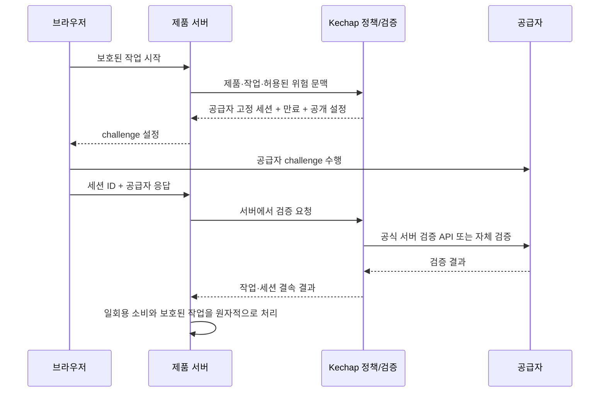

# Kechap 아키텍처

Kechap의 제품 단위는 **인증 공급자를 선택하고 연결하는 정책 레이어**다. 새 CAPTCHA 하나를 만드는 것보다, 제품 요구를 입력하면 근거가 있는 후보·설정·서버 검증 경로를 얻고 운영 중 정책에 따라 공급자를 바꾸는 경험을 먼저 완성한다.

이 문서는 목표 아키텍처다. 구현된 명령과 API의 실제 사용법은 루트 README와 코드가 기준이다. SDK, MCP, Skill은 같은 공급자 카탈로그와 정책을 공유해야 하며, 추천 결과가 실제 배포나 보안 검증 완료를 뜻하지 않는다.

## 인터페이스의 역할

| 인터페이스 | 사용자 | 책임 |
| --- | --- | --- |
| 카탈로그 | 개발자·기여자 | 방법론, 원본 저장소, 라이선스, 검증 근거, 개인정보·접근성 제약 기록 |
| SDK | 제품 서버 | 허용된 후보 선택, 세션과 공급자 결속, 서버 검증, 만료·재사용 차단 |
| CLI | 개발자·CI | 요구사항 입력, 설명 가능한 추천, 설정 초안 생성, 카탈로그 검사 |
| MCP | AI 코딩 에이전트 | 검색·추천·설정 생성 도구를 표준 인터페이스로 제공 |
| Skill | AI 코딩 에이전트 | 제품 질문, 선택 근거, 서버 통합, 환경변수, 접근성 경로, 검증 체크 순서 제공 |
| 벤치마크 | 운영자·연구자 | 동일 조건에서 인간 경험과 자동화 비용을 측정하고 한계 공개 |

MCP가 인증 비밀키를 반환하거나 에이전트가 CAPTCHA를 대신 풀게 하지 않는다. 에이전트는 제품에 방어를 설치한다. 실제 통과 여부는 제품 서버와 공급자 검증 API가 판단한다.

## 현재 MVP와 운영 경계

현재 구현의 중심은 `src/index.js`다. `Kechap.issue({context: {tenant, action, subject}, providers, assurance, sessionId, mode, previous})`가 세션의 공급자를 고정하고, `verify({id, context, response})`가 서버 검증 후 짧게 유효한 불투명 토큰을 발급한다. 제품 서버는 `consume({token, context})`로 토큰을 일회용 소비한 뒤 해당 작업을 수행한다. `issueWithPolicy`는 서버 action/risk별 설정·health·weighted선택과 policyVersion고정을 추가로 제공한다. 기본 `mode`는 `stable` 또는 `rotate`이며 `previous`는 로테이션 입력이다. 자세한 입력 제약은 코드와 테스트를 기준으로 한다.

`MemoryStore`는 데모용이다. 운영에서는 원자적인 `put`/`take` 계약을 구현한 공유 저장소가 필요하다. 토큰 소비와 실제 지급·게시 작업 사이의 장애를 제품 트랜잭션 또는 idempotency key로 처리해야 한다.

`siteverifyAdapter`는 Turnstile/hCaptcha/reCAPTCHA의 공식 검증 endpoint와 hostname/action/score 조건을 사용하며 오류 시 실패한다. `powAdapter`는 실험적인 automation-cost 예제로, 인간 존재를 검증하는 공급자가 아니다. 현재 MCP의 catalog/recommend/plan/scaffold 도구는 읽기·계획·신규 Node HTTP 파일 생성용이며 인증 세션이나 토큰을 발급하지 않는다. ALTCHA/Cap은 공식 패키지 실제 통합과 브라우저 검증을 수행했다. replay는 세 가지 toy world와 benchmark가 구현되어 있으나 인간 구별 성능은 미검증이다. 분산 저장소·운영 대시보드·liveness는 백로그다.

## 보장의 구분

현재 SDK의 assurance 문자열은 `automation-cost`, `bot-mitigation`, `interaction`, `liveness`, `identity`, `uniqueness`다. 아래 분류는 장기 카탈로그 설계로, 현재 API enum과 일치한다고 가정하지 않는다. PoW는 automation-cost이며 CAPTCHA는 bot-mitigation에 해당한다. 비교 표와 추천은 서로 다른 보장을 하나의 “사람 점수”로 만들지 않는다.

- `anti-abuse`: PoW, 속도 제한, 봇 위험 신호. 요청 비용을 올리지만 사람의 존재를 증명하지 않는다.
- `interaction`: 퍼즐·게임·행동 검증. 현재 상호작용의 증거이며 인간 작업자 대행을 배제하지 못한다.
- `liveness`: 살아 있는 사람의 현재 존재를 확률적으로 평가한다.
- `identity`: 등록된 신원과의 일치. 외부 KYC 또는 별도 등록 절차가 필요하다.
- `personhood`: 서비스 정책 범위의 중복 사람 검증. “전 세계 유일”과 동의어가 아니다.
- `account-continuity`: passkey 등 기존 계정 소유 연속성. 최초 가입자의 인간 여부를 보장하지 않는다.

공급자 이름, 별 수, PoW 성공을 `human=true`로 변환하는 공통 API는 만들지 않는다. attestation에는 검증된 범주·공급자·정책 버전을 명시한다.

## 선택과 운영 중 로테이션

선택은 두 단계다. 먼저 self-host 요구, 상업 라이선스 허용 범위, 데이터 지역, 생체정보 동의, 키보드 대체 경로, 요구 보장 범주 같은 필수 제약으로 후보를 걸러낸다. 이후 지연·비용·운영 복잡도·공개 근거를 비교해 추천한다. GitHub 10,000 stars 조건은 품질 증명이 아닌 별도의 선호 필터로 둔다. 확인하지 못한 별 수는 `unknown`이며 임의로 통과 처리하지 않는다.

운영 중에는 검토된 공급자 집합 안에서만 가중치·건강 상태·정책 버전으로 선택한다. 선택 결과는 세션 발급 때 고정한다. 이미 발급된 challenge의 검증 공급자를 바꾸지 않는다. 더 약한 공급자로 조용히 전환하는 정책은 금지하고, 요구 보장을 만족하는 공급자가 없으면 추가 인증이나 명시적인 지원 경로로 전환한다.

예를 들어 문의폼은 self-host PoW와 속도 제한을 사용할 수 있다. 보상 지급은 같은 정책을 복사하지 않고 보상 중복·계정 연속성 요구를 별도로 선언한다. 얼굴 liveness는 동의와 대체 경로가 준비된 고위험 흐름에만 후보로 포함한다.

## 목표 서버 흐름

서버 저장소는 nonce, 공급자, 정책 버전, action, 허용 origin/sitekey, 발급·만료 시각, 소비 상태를 관리한다. 수평 확장 환경에서는 Redis/DB의 원자적 compare-and-set 또는 트랜잭션이 필요하다. 메모리 저장소는 예제·단일 프로세스 개발 용도임을 명시한다. IP를 무조건 결속하면 모바일 네트워크 전환과 공유망에 문제가 생기므로 정책 선택으로 둔다.

공식 API가 제공하는 hostname/action/cdata 등의 필드를 가능한 범위에서 검증한다. 제공하지 않는 보장을 있는 것처럼 표시하지 않는다. 네트워크 오류와 자격 증명 오류는 실패한 검증이며, 자동 성공으로 바꾸지 않는다.

## 공급자 기여 계약

새 adapter는 공개 manifest, 공식 문서 URL, 라이선스·재배포 조건, 서버 검증 코드, 실패 모드, 키 관리 설명, 접근성 제약, 계약 테스트를 함께 제공한다. 카탈로그 등록과 실행 가능한 adapter 등록은 별도 단계다. 기록만 있는 공급자는 사용 가능하다고 표시하지 않는다.

비공개 공급자는 공식 SDK/API와 허용된 문서만 연결한다. REA와 같은 분석 도구는 허용된 소유·테스트 환경의 동작 이해와 호환성 조사에 사용할 수 있지만, 비공개 엔진 추출·재배포를 공급자 구현으로 취급하지 않는다. 자산·모델·프롬프트·코드를 복사할 권한은 각각 확인해야 한다.

## 이후 interaction replay 확장

서버가 생성한 seed와 nonce로 짧은 toy environment를 만들고 클라이언트 입력 이벤트를 서버가 재생한다. 이벤트 수·크기·시간·속도를 제한하고, 최종 점수나 클라이언트 타임스탬프를 신뢰하지 않는다. 재생 성공은 게임 규칙 충족을 뜻한다. 실제 인간이라는 강한 주장은 별도의 실험과 공격 모델 평가 이후에만 가능하다.

새 replay 엔진은 기존 공급자 orchestration의 플러그인으로 추가한다. 먼저 기본 연동을 제품에서 사용할 수 있게 하고, 벤치마크 근거가 없는 실험 게임을 기본 추천으로 올리지 않는다.
